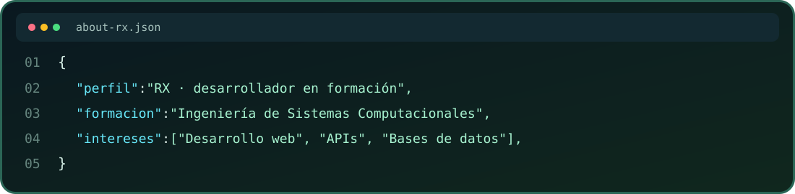
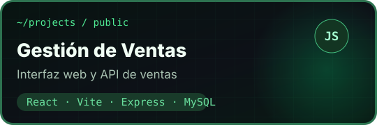
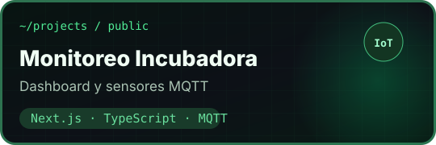
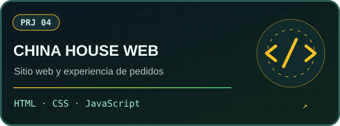
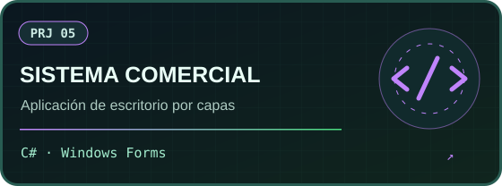
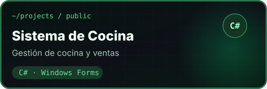

  

   

  
  

 

## `yamix-rx@github ~ $ whoami`

  

- 💻 Desarrollo aplicaciones web y de escritorio.
- 🛠️ Desarrollo con **C#, JavaScript, TypeScript, React, Next.js, Node.js, Express y MySQL**.
- 📂 Aquí comparto proyectos, prácticas y sistemas que voy construyendo.

## `yamix-rx@github ~ $ ls ./stack`

## `yamix-rx@github ~ $ ./stats.sh`

  
  

  

> Las estadísticas anteriores son dinámicas y dependen de servicios externos. Si alguno tiene un límite temporal, puede tardar en mostrarse.

## `yamix-rx@github ~ $ ./contributions.sh`

  <picture>
    <source media="(prefers-color-scheme: dark)" srcset="https://raw.githubusercontent.com/yamix-rx/yamix-rx/output/github-contribution-grid-snake-dark.svg" />
    <source media="(prefers-color-scheme: light)" srcset="https://raw.githubusercontent.com/yamix-rx/yamix-rx/output/github-contribution-grid-snake.svg" />
    
  </picture>

La animación aparece cuando se ejecuta por primera vez la acción <code>Generate GitHub Snake</code> en la pestaña Actions del repositorio.

## `yamix-rx@github ~ $ ls ./projects`

**6 proyectos públicos**, desde aplicaciones de escritorio hasta plataformas web y monitoreo de dispositivos.

  
  
  
  
  
  

  

  <b>Gracias por visitar mi perfil.</b> 🚀

